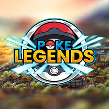

<p align="center">
  
</p>

<h1 align="center">Pokémon Mythicals</h1>

<p align="center">
  <strong>The Ultimate Pokémon Discord Community</strong>
</p>

<p align="center">
  <a href="https://pokemythicals.org">Website</a> •
  <a href="https://discord.gg/HbXGMCaX2d">Discord</a> •
  <a href="https://twitter.com/pokemonmythicals">Twitter</a>
</p>

<p align="center">
  
  
  
  
</p>

---

## About Pokémon Mythicals

**Pokémon Mythicals** is the most epic and immersive Pokémon community on Discord. We bring together trainers from around the world to battle, trade, compete, and form lasting friendships in the ultimate Pokémon experience.

Whether you're a seasoned champion or just starting your journey, Pokémon Mythicals offers something for everyone. Join **50,000+ trainers** and become a mythical today!

### Why Choose Pokémon Mythicals?

- **Epic Battles** - Engage in thrilling Pokémon battles with trainers worldwide
- **Weekly Tournaments** - Compete for glory and climb the mythical leaderboards
- **Trading Hub** - Trade rare Pokémon and build your ultimate collection
- **Mini Games** - Enjoy exclusive Pokémon-themed games and activities
- **Pokédex Wiki** - Access comprehensive guides and strategies for every Pokémon
- **Daily Rewards** - Earn exclusive rewards through daily activities
- **Active Community** - 24/7 active chat with friendly trainers and helpful staff
- **Regular Events** - Special seasonal events with exclusive prizes

---

## Website Features

This repository contains the official **Pokémon Mythicals** website built with cutting-edge web technologies:

### Tech Stack

- **Next.js 16** - React framework with App Router
- **TypeScript** - Type-safe development
- **Tailwind CSS** - Utility-first styling
- **Framer Motion** - Smooth, performant animations

### Visual Features

- Epic animated pre-loader with Pokéball catching sequence
- Stunning parallax hero section with aurora effects
- Floating legendary Pokémon silhouettes
- 100+ animated stars and shooting star effects
- Glowing Discord integration buttons
- Animated feature cards with hover effects
- Custom gradient scrollbar
- Fully responsive design

---

## Getting Started

### Prerequisites

- Node.js 18+
- npm or yarn

### Installation

```bash
# Clone the repository
git clone https://github.com/NexusRisen/PokeLegends.git

# Navigate to the project
cd PokeLegends

# Install dependencies
npm install

# Start development server
npm run dev
```

Open [http://localhost:3000](http://localhost:3000) to view the site.

### Build for Production

```bash
npm run build
npm start
```

---

## Join Our Community

Ready to become a Pokémon Mythical? Join our Discord server today!

<p align="center">
  <a href="https://discord.gg/HbXGMCaX2d">
    
  </a>
</p>

### Connect With Us

- **Website:** [pokemythicals.org](https://pokemythicals.org)
- **Discord:** [discord.gg/HbXGMCaX2d](https://discord.gg/HbXGMCaX2d)
- **Twitter:** [@pokemonmythicals](https://twitter.com/pokemonmythicals)

---

## Contributing

We welcome contributions from the community! If you'd like to help improve the Pokémon Mythicals website:

1. Fork the repository
2. Create your feature branch (`git checkout -b feature/AmazingFeature`)
3. Commit your changes (`git commit -m 'Add some AmazingFeature'`)
4. Push to the branch (`git push origin feature/AmazingFeature`)
5. Open a Pull Request

---

## License

This project is licensed under the MIT License - see the [LICENSE](LICENSE) file for details.

---

## Disclaimer

Pokémon and all respective names are trademark & © of Nintendo/Creatures Inc./GAME FREAK inc. This is an unofficial fan community and is not affiliated with, endorsed, sponsored, or specifically approved by Nintendo, Creatures Inc., or GAME FREAK inc.

---

<p align="center">
  <strong>Gotta Catch 'Em All!</strong>
</p>

<p align="center">
  Made with ❤️ by the Pokémon Mythicals Team
</p>

<p align="center">
  <a href="https://pokemythicals.org">pokemythicals.org</a>
</p>
